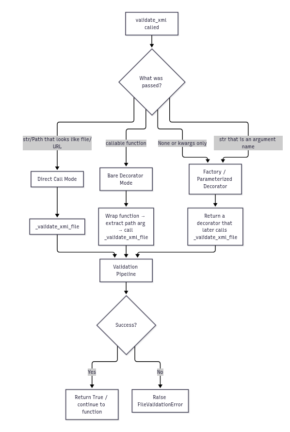

# XML Validation

This section outlines specific implementation details for the `validation_xml` functionality.

## High Level Flow

Explanation of the Main Stages:

| Stage | What happens | Security goal |
| --- | --- | --- |
| 1. Entry point | validate_xml decides whether it is being used as a direct call, a decorator, or a factory. | Flexible API without sacrificing safety. |
| 2. URL / Path validation | _validate_url_scheme rejects anything that is not a local path or a pure https:// URL. Protocol-relative URLs (//...) and other schemes are blocked. | Prevents SSRF and scheme-downgrade attacks. |
| 3. Size check (early) | Local files: stat(). Remote files: optional HEAD + hard limit on GET. | Stops huge files before they are fully loaded. |
| 4. Safe reading + GZip | Content is read with a hard size limit. GZip is decompressed with the same size limit on the decompressed data. | Protects against GZip bombs. |
| 5. DOCTYPE rejection | Simple regex rejects any <!DOCTYPE. | Completely eliminates XXE and classic entity-expansion attacks. |
| 6. Structural validation | XMLSecurityValidator parses the XML and walks the tree iteratively (no recursion). It enforces depth, element count, attribute count, name length and text length. | Protects against deep nesting, attribute bombs, large text nodes, etc. |
| 7. Error handling | Every failure raises FileValidationError with a clear message. | Consistent, easy-to-catch security errors. |

Key Design Decisions: 
- No raw XML strings – only file paths / HTTPS URLs are accepted.
- HTTPS-only + redirect protection – HTTPSOnlyRedirectHandler blocks any redirect to a non-HTTPS location.
- Iterative tree walk – avoids Python recursion limits even on very deep (but still limited) documents.
- Early rejection – size and scheme checks happen before expensive parsing.
- Decorator & factory support – the same validation pipeline is reused whether you call the function directly or decorate another function.

In the table below outlines how functionality implemented in `validate_xml` and its underlying functions (`_validate_xml_file`, `XMLSecurityValidator`, and `HTTPSOnlyRedirectHandler`) are created:

| Check | Description | Code Implementation |
| --- | --- | --- |
| **Max File Size** | Enforces maximum XML file size (bytes) | Checks local `st_size`, HTTP `Content-Length`, and caps standard/gzipped streaming reads at `max_file_size`. |
| **Max Nesting Depth** | Prevents deeply nested elements causing stack overflow | `XMLSecurityValidator._validate_tree` enforces `depth > self.max_depth` check on stack items. |
| **Max Elements** | Limits total element count to prevent DoS | Increments `self.element_count` during traversal and raises if it exceeds `self.max_elements`. |
| **Max Attributes** | Caps attributes per element | Checks `len(element.attrib) > self.max_attributes` inside `_validate_tree`. |
| **Max Text Length** | Limits text node and attribute value sizes | Checks `element.text`, `element.tail`, and `attribute value` string lengths against `self.max_text_length`. |
| **Max Name Length** | Limits element and attribute name lengths | Validates both `element.tag` and attribute keys against `self.max_name_length`. |
| **DOCTYPE Rejection** | Blocks DTD declarations (XXE, entity expansion) | `_reject_doctype` uses regex `_DOCTYPE_RE` (`<!DOCTYPE`) to reject any document with DTD declarations. |
| **GZip Support** | Handles compressed XML with size limits | Checks for magic header `b"\x1f\x8b"` or `gzip` content-encoding and safely streams via `_read_gzip_stream` using `max_file_size`. |
| **UTF-8 Validation** | Rejects files with invalid UTF-8 encoding | Decodes with `errors="strict"` and explicitly catches `UnicodeDecodeError`. |
| **Remote File Restriction** | Strictly restricts remote access to HTTPS only | `_validate_url_scheme` and `HTTPSOnlyRedirectHandler` block non-HTTPS schemes and HTTP downgrades. |
| **Parser Hardening** | Uses defusedxml-style protections against known XML attacks | Combines custom tree traversal depth/size limits with strict DOCTYPE rejection, preventing XXE, quadratic blowup, and Billion Laughs entity expansion. |